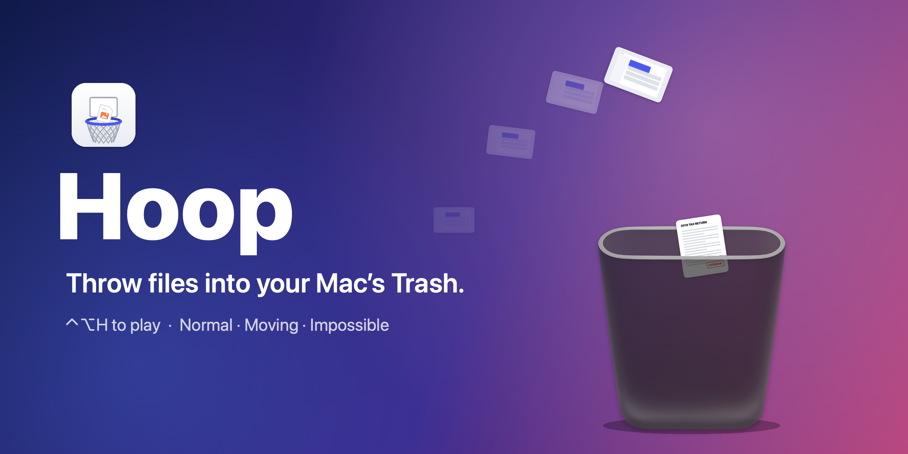

<p align="center"></p>

# Hoop

A tiny macOS menu bar app that turns your Trash into a basketball hoop. Drag a file off your desktop, swing, let go: it flies with the momentum of your drag, and if it lands in the can it goes to the Trash.

▶️ **[Watch the demo on X](https://x.com/SafaElmali/status/2109377706567844051)**

## Play

- **⌃⌥H** (or 🏀 in the menu bar) turns on shoot mode: the Dock's Trash grows into a basket. **Esc** turns it off.
- With more than one display, shoot mode starts on the screen under the pointer; away from the Dock, the Trash waits at the bottom centre.
- Drag any file and let go mid-swing. In the can → Finder moves it to the Trash, just like dropping it on the Dock's Trash (so **Put Back** works), with **Undo** in the toast and the 🏀 menu.
- Miss → the file stays put. A desktop file's icon moves to where it landed.
- Drop a file straight onto the Trash for a dunk.
- Turn on the **Backboard** and the Trash gets a glass board on its outer side: bounce a file off it and in for a bank shot.
- Turn on the **Folder Hoop** and a second hoop shows up at the bottom left, with a folder's icon and name on its board. Swish a file through it and it moves into that folder (with **Undo**).
- Long shots, bank shots, clean swishes and dunks get their own callouts. Three in a row and you're on fire: thrown files trail flames until you miss.
- Drag the Trash or the folder hoop to put it anywhere; 🏀 → **Put Trash Back on Dock** resets the Trash.

## Options (🏀 menu)

- **Shot Clock**: 30 seconds to make as many as you can. A rack of paper balls shows up across from the Trash: grab one and flick it. They're only paper, so nothing gets trashed and Stats stay put; files you throw count too. Click it again to call the round off.
- **Mode**: Normal · Moving (the Trash glides back and forth) · Impossible (it dodges every shot)
- **Trash Size**: Small · Medium · Large · Huge · Dock Size (the real Trash in your Dock: its size, its spot)
- **Backboard**: a glass backboard on the grown Trash, for bank shots
- **Folder Hoop**: Off · Downloads · Desktop · Documents · Choose Folder… (it stays put in every mode)
- **Stats**: makes, misses, best streak and how much you've trashed
- **Sounds**: Classic (whooshes, can clanks and landings; a make plays Finder's own trash sound) · Arcade (8-bit, with a coin jingle for a make) · Stadium (a ringing rim, and an air horn over the crowd for a make) · Off
- **Shortcut…**: record your own shortcut for shoot mode
- **Open at Login**

## Install

Needs macOS 14 or later. Runs on Apple silicon and Intel Macs.

1. Download `Hoop-<version>.zip` from the [Releases page](https://github.com/SafaElmali/hoop/releases).
2. Unzip it and move **Hoop.app** to Applications.
3. Hoop isn't notarized yet, so open it the first time with right-click → **Open**. On macOS 15 or later, try to open it once, then click **Open Anyway** in System Settings → Privacy & Security. Or skip the dialog from Terminal:

   ```bash
   xattr -dr com.apple.quarantine /Applications/Hoop.app
   ```

On first launch macOS asks for **Accessibility** (to find the Trash in the Dock). The first make asks to let Hoop **control Finder** (to trash files the way Finder does, and to move a missed file's icon to where it landed). The app is ad-hoc signed, so after an update or a rebuild macOS may ask again.

### Build from source

Needs the Swift toolchain (Xcode or the Command Line Tools).

```bash
git clone https://github.com/SafaElmali/hoop.git
cd hoop
./build.sh
open build/Hoop.app
```

## How it works

```
 Finder drag ──► drag pasteboard changes while the button is down
                       │  (polled 60×/s, only in shoot mode)
                       ▼
 OverlayWindow: full-screen, click-through panel ──arms──► becomes the drop target
                       │  dragging updates → fling velocity
                       ▼
 CourtScene (SpriteKit physics): file flies ──► inside the can? ──► FileManager.trashItem + Undo
                                                ├─ through the folder hoop? ──► moved into its folder + Undo
                                                └─ miss ──► Finder moves the desktop icon there
 DockTrash (Accessibility API) ──► Trash tile frame ──► where the basket grows from
```

- `Sources/Hoop/`: the app (AppKit + SpriteKit, no dependencies).
- `Promo/` + `promo.sh`: renders the demo video and the cover from the game's own code (needs `ffmpeg`).

## Releasing

Bump `CFBundleShortVersionString` and `CFBundleVersion` in `Info.plist`, then:

```bash
./release.sh
```

It builds a universal Hoop.app (Apple silicon + Intel; needs Xcode), zips it to `build/Hoop-<version>.zip` and prints its SHA-256. Attach the zip to a GitHub release.

It's ad-hoc signed by default. With a Developer ID, set `SIGN_IDENTITY` to sign it with the hardened runtime, and `NOTARY_PROFILE` (a `xcrun notarytool store-credentials` profile) to notarize and staple it too:

```bash
SIGN_IDENTITY="Developer ID Application: …" NOTARY_PROFILE=hoop ./release.sh
```

## License

MIT
